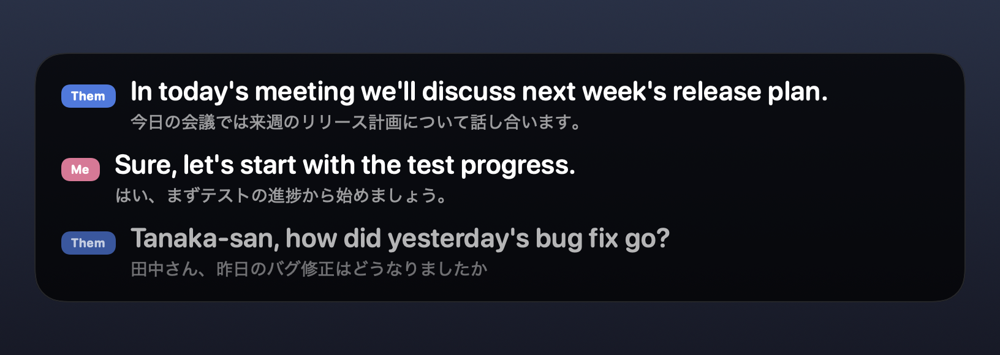

<p align="center">
  
</p>

<h1 align="center">Traqula</h1>

<p align="center">
  Live captions for meetings on your Mac, translated on-device.
</p>

<p align="center">
  <a href="LICENSE"></a>
  <a href="https://github.com/RonitSachdev/Traqula/releases/latest"></a>
</p>

<p align="center">
  
</p>

Traqula listens to what your Mac plays (Google Meet, Zoom, anything) and to your microphone, recognizes
speech on-device, translates it on-device, and shows the result in a floating caption card. Every
finalized line is written to a plain-file meeting record, and a bundled MCP server lets any AI assistant
read, search, and summarize your meetings.

Nothing leaves the Mac: speech recognition and translation both use Apple's on-device models.

## Download

Grab `Traqula-x.y.z.zip` from the [latest release](https://github.com/RonitSachdev/Traqula/releases/latest),
unzip, and move Traqula.app to Applications. The build is not notarized yet, so open it the first time
with right-click → Open.

## Requirements

- macOS 26.0 or later (Apple's `SpeechAnalyzer` and headless `TranslationSession` are macOS 26 APIs).
- Xcode 26.1 or later.
- [XcodeGen](https://github.com/yonaskolb/XcodeGen) (`brew install xcodegen`) to generate the Xcode project.

## Build and run

```sh
xcodegen generate          # creates Traqula.xcodeproj from project.yml
open Traqula.xcodeproj     # then Run, or:
xcodebuild -project Traqula.xcodeproj -scheme Traqula -configuration Debug build
xcodebuild -project Traqula.xcodeproj -scheme Traqula -configuration Debug test
```

The project signs "to run locally" by default. Pick your team under Signing in Xcode so macOS keeps the
app's permissions across rebuilds; with ad-hoc signing every new build is a new app to the privacy system.

### First run

1. Open **Settings** from the menu bar icon and press **Download** next to the translation pair
   (Japanese → English by default). Apple only offers that download through a system sheet, which is
   why it lives in Settings rather than happening automatically. Models are shared with every app.
2. Press **Start Captions**. macOS asks for **System Audio Recording** and **Microphone** access.
   If you denied one, re-enable it under System Settings › Privacy & Security.
3. Captions appear in a floating card at the bottom of the screen. Drag it anywhere; it stays above
   full-screen apps and never steals keyboard focus.

## Ask your AI about a meeting

Traqula ships an MCP server inside the app (`Traqula.app/Contents/MacOS/traqula-mcp`). Any MCP client can
use it: Claude Desktop, Claude Code, Cursor, Windsurf, Codex CLI, Gemini CLI, and others. Open
**Settings › AI assistants** and press **Connect** next to an installed app, or copy the command or config
for the rest. It only reads your meeting files; nothing leaves the Mac unless the assistant you connect
sends it.

| Tool | What it returns |
| --- | --- |
| `list_meetings` | Recorded meetings, newest first, with id, time, length, and line count |
| `get_transcript` | One meeting as `[mm:ss] Them: …` / `Me: …` lines; filter by time range, speaker, original or translated text |
| `search_transcripts` | Lines across all meetings that contain a word or phrase, in either language |
| `meeting_summary` | Summary, decisions, action items, and open questions, written on-device by Apple Intelligence and cached as `summary.md` |
| `live_meeting` | The last few minutes of the meeting being captioned right now |

Example, once connected: *"Summarize this morning's meeting and list the decisions"* or *"What did they
just say about the release date?"* during a call. Summaries need Apple Intelligence turned on; long
meetings are summarized part by part and merged.

Manual setup, if you prefer: add `{"mcpServers": {"traqula": {"command": "/Applications/Traqula.app/Contents/MacOS/traqula-mcp"}}}`
to your client's MCP config, or `claude mcp add --scope user traqula /Applications/Traqula.app/Contents/MacOS/traqula-mcp`
for Claude Code. The server takes `--meetings <folder>` to read a different folder.

## How it works

```
SystemAudioTap ─┐                                 ┌─ CaptionTimeline ─ CaptionView (floating panel)
                ├─ LiveTranscriber ─ CaptionSession ┤
MicrophoneSource┘   (per channel)       │          └─ Translator (per final + debounced partials)
                                        └─ MeetingRecord (meeting.json + transcript.jsonl)
                                                         │
                                           traqula-mcp ──┘  (reads the same files for any MCP client)
```

- **Audio** (`Traqula/Audio`): `SystemAudioTap` is a Core Audio process tap wrapped in a private
  aggregate device, so there is no virtual audio driver and no screen-recording permission.
  `MicrophoneSource` is an `AVAudioEngine` input tap. Both implement `AudioSource` and hand over
  owned buffers.
- **Speech** (`Traqula/Speech`): `LiveTranscriber` runs one `SpeechAnalyzer` per channel with the
  `DictationTranscriber` module and forces finalization at sentence punctuation or after 2.5 s of
  unchanged text. See "Why the dictation module" below.
- **Translation** (`Traqula/Translation`): `AppleTranslator` wraps a headless `TranslationSession`
  behind the `Translator` protocol so a cloud or LLM translator can replace it later.
- **Captions** (`Traqula/Captions`): `CaptionTimeline` is the pure, tested bookkeeping of lines;
  `CaptionSession` wires audio → transcription → translation → timeline and record.
- **Records** (`Packages/MeetingRecords`): a small Swift package shared by the app and the MCP server.
  `MeetingRecord` appends one JSON utterance per line; `MeetingLibrary` lists, reads, and searches meetings;
  `MeetingSummarizer` writes summaries with the on-device Foundation Models framework.
- **MCP server** (`TraqulaMCP`): a stdio server on the official MCP Swift SDK, bundled into the app.
- **UI** (`Traqula/UI`): menu bar menu, the Liquid Glass caption panel, Settings.

### Data on disk

`~/Library/Application Support/Traqula/Meetings/<yyyy-MM-dd HH-mm-ss>/`

- `meeting.json` — id, start and end time.
- `transcript.jsonl` — one `Utterance` per line: channel (`system` = them, `microphone` = me),
  absolute start time, duration, source and target language, source text, translated text.

- `summary.md` — written the first time a summary is requested, refreshed when the transcript grows.

Plain files on purpose: anything can read a meeting without this app.

### Why the dictation module

Measured on macOS 26.5 by streaming paced speech through the real pipeline:

| Module | First partial | Finals |
| --- | --- | --- |
| `SpeechTranscriber` (`.volatileResults`) | Only at an utterance boundary, as one burst | 8–10 s after a clear 2 s pause |
| `DictationTranscriber` (`.progressiveLongDictation`) | ≈0.5 s, then every 0.2–0.7 s | Never on its own; ≈50 ms after `finalize(through:)` |

Live captions need the second row, so Traqula uses the dictation module and finalizes segments itself.
Idle delays of 1.5 s and 2.0 s cut sentences at comma pauses; 2.5 s produced clean sentence boundaries.
Transcripts of the Japanese and English test samples matched the spoken text.

## Project layout

```
project.yml            XcodeGen spec (targets, packages, Info.plist keys, signing)
Traqula/               App sources, grouped by layer as above
Traqula/Resources/     Asset catalog (app icon, menu bar glyph) generated by Tools/render-icon.swift
TraqulaMCP/            The MCP server (built as traqula-mcp and copied into the app bundle)
Packages/MeetingRecords  Meeting records (writer, reader, search) and summaries, with their own tests (`swift test`)
TraqulaTests/          Swift Testing suite for CaptionTimeline
Tools/render-icon.swift  Draws the mascot (bubble, oval eyes, one fang) and renders every icon size
```

## Contributing

Issues and pull requests are welcome. See [CONTRIBUTING.md](CONTRIBUTING.md) for setup and the ground
rules (short version: everything stays on-device, Swift 6 strict concurrency, icons are code).

## License

[MIT](LICENSE) © 2026 Ronit Sachdev
